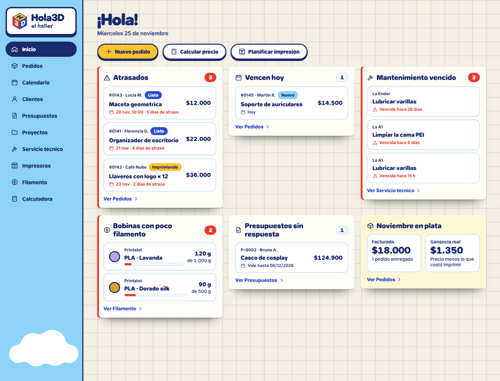

# Hola3D Taller

The internal workshop app for Hola3D, a 3D printing shop. It tracks every order from the first message to the delivery, on one board.




## Status

| Section | State |
|---|---|
| Pedidos (orders) | Works end to end: board, search, new order (pick a client or type a new one, and optionally one of that client's active projects), stage moves. Cards show their project as a small label; the order detail shows the project with a link and changes or clears it. The order detail logs print jobs (printer, time, grams per spool, result, and optionally labour minutes and an extra cost; a retried save is stored once); each job's cost is frozen when logged, and the detail shows the real cost in six terms and the real profit next to the price. It also plans prints (printer, day, time, duration), changes or deletes a plan, and finishes a planned print with the log form prefilled with its printer and estimated time. `/pedidos?pedido=0142` opens that order's detail |
| Clientes (clients) | List with search, create and edit. Client page with contact links, orders, projects, total spent and balance owed |
| Proyectos (projects) | List with an active/finished filter: client, due date (overdue when past and still active), progress and totals. Create and edit with the client picker. Project page with its orders and their stages, progress (delivered ÷ all orders), price, deposits and balance; add an order of that client that has no project, take one out, mark the project finished or reopen it |
| Impresoras (printers) | List, create and edit. Shows accumulated print hours and machine wear per print hour; logged print jobs add their hours. A new printer comes with the default service plan unless unticked; each card shows a badge with its service tasks due (it links to Servicio técnico), or offers the plan when it has none |
| Servicio técnico (machine service) | Recurring tasks per printer, due by print hours or days, whichever comes first: what is due first, then what comes next with how much is left. Log a service from a task (it restarts that task's count) or on its own, with parts and cost; the log and the service cost per printer. Filter by printer. Create, edit and deactivate tasks; adopt the default plan |
| Filamento (spools) | List, create and edit. Filter by material, total stock in grams, low-stock warning; logged print jobs take their grams off |
| Calculadora (calculator) | Prices one or more pieces with the real cost breakdown, total and price per unit, live. Edits the workshop costs. Saves the calculation as a quote for a client |
| Presupuestos (quotes) | List with status filter and totals. Quote page with the frozen lines and breakdown; mark sent, accept into orders, reject, print view for PDF, WhatsApp message. Client pages list their quotes; orders link back to their quote |
| Calendario (calendar) | Month and week views with previous, next and "Hoy". The month shows each day's due orders, project due dates, service tasks due by date and planned prints as small labels by type (with "+N más" when they do not fit); a day opens its week. The week shows due orders (late ones in red), projects and service at the top, and below one row per active printer with its planned prints, each in its own day's column, placed by start time and length on a scale of the hours that week's prints use (from the earliest start to the latest end, in whole hours, at least 08:00 to 20:00) with hour marks; a print's label stays in its day's column, cut short with the full text on hover, and a print past midnight shows its part on each day; a day of a printer's row plans a print there, and a print opens its plan to change or delete it. Orders open their detail in Pedidos, projects their page, service tasks Servicio técnico. On a phone the week is a list of days |
| Inicio (home) | Greeting with today's date and quick actions (new order, price calculator, plan a print). One card per list, most urgent first: late orders, orders due today, service tasks due, low spools and sent quotes waiting for an answer, each with its count, its first five items, a friendly empty state and a link to its section; then this month's revenue and real profit, marked partial when delivered orders have no print jobs logged yet. `/pedidos?nuevo=1` opens the new order form and `/agenda?planificar=1` the plan dialog |
| Deploy to `app.hola3d.com.ar` | Not done yet, see [Deploy](#deploy) |

The app has no login of its own. It is meant to run behind Cloudflare Access, so do not deploy it without that step.

## Run it locally

You need Node.js 22 or newer. Nothing here touches a Cloudflare account: the database is a local D1 copy.

```bash
npm install
npm run db:migrate   # create the local D1 tables
npm run db:seed      # load sample clients, projects, quotes, orders, printers, spools, print jobs (logged and planned), service tasks and logs, and cost settings
npm run dev
```

Open the URL Vite prints and go to **Pedidos**. On a phone the bottom bar has Inicio, Pedidos, Calendario and Clientes; **Más** opens a sheet with the other sections.

## Checks

```bash
npm test             # Vitest: domain rules, API routes, API dispatch, formatting
npm run typecheck
npm run lint
```

## How it is built

One Cloudflare Worker serves both the React app and the API, and stores data in D1 (SQLite).

| Folder | What lives there |
|---|---|
| `src/` | React 19 app (Vite, React Router). One folder per screen in `features/` (`home/` is Inicio, `orders/` is Pedidos, `clients/` Clientes, `printers/` Impresoras, `spools/` Filamento, `calculator/` Calculadora, `quotes/` Presupuestos and the quote print view, `service/` Servicio técnico, `projects/` Proyectos and the project page, `calendar/` Calendario and the plan-a-print dialog), `shell/` the navigation, `ui/` pieces the screens share (API calls, form dialog, icons, keeping only the newest request's answer) |
| `worker/` | The Worker: API under `/api/*`, everything else is the single-page app. One folder per module (`orders/`, `print-jobs/` (logged and planned jobs; its `d1.test.ts` runs the D1 adapter's SQL on a real SQLite database from Node's `node:sqlite`, through the test helper `sqlite-d1.ts`), `calendar/` and `dashboard/` (read the other modules' ports, no storage of their own), `clients/`, `projects/`, `printers/`, `spools/`, `settings/`, `quotes/`, `service/`) with its routes and a storage port with a D1 and an in-memory adapter (the in-memory adapters share tables, `memory.ts`, where they read each other's rows); `index.ts` tries each module in turn |
| `shared/` | Rules used by both sides: order stages, validation and search; client validation, name matching, total spent, balance owed and contact links; printer validation, hours and wear cost; spool validation, low stock, material filter and stock totals; cost settings validation and defaults; the cost formula and spool shortages for the calculator; quote validation, status rules, the orders a quote becomes and its WhatsApp message; print job validation, the cost of one job and the real cost of an order from its jobs' stored costs; service task and log validation, when a task is due and how much is left, the due-first order, the default plan and the service cost per printer; project validation, progress, totals, when a project is overdue and the one-client rule for its orders; the calendar's dates, ranges, overlap of planned prints, when a service task is due by date, and what falls in a range; the home screen's lists and month totals |
| `migrations/` | D1 schema, one file per change |
| `seed/` | Sample clients, projects, quotes, orders (one delivered this month), printers, spools, print jobs (logged, and planned in this week and the next), service tasks and logs, and cost settings, for local use only. As of 2026-11-25 every block of the home screen has something in it |

An order moves through five stages, in order:

`nuevo` → `disenando` → `imprimiendo` → `listo` → `entregado`

## API

| Method | Path | What it does |
|---|---|---|
| GET | `/api/orders` | List all orders. Each one has `client` (the client's name), `clientId`, `quoteId` (the quote it was accepted from, or null), `projectId` and `project` (its project's id and name, or null), `realCost` and `realProfit` (from its print jobs; null while it has none), and `deliveredAt` (when it moved to `entregado`; null while not delivered) |
| POST | `/api/orders` | Create an order. It starts in `nuevo` and takes the next number, padded to four digits. With `projectId`, it goes in that project |
| PUT | `/api/orders/:id/stage` | Move an order to another stage. Moving to `entregado` stamps `deliveredAt` (moving there again keeps the first stamp); any other stage clears it |
| PUT | `/api/orders/:id/project` | Put the order in a project of its client with `{"projectId": 3}`, or take it out of any with `{"projectId": null}` |
| GET | `/api/orders/:id/jobs` | The order's print jobs, oldest first, each with its stored `cost`, and `cost`: the order's real cost term by term (null without jobs), added up from the jobs in the same answer |
| POST | `/api/orders/:id/jobs` | Log a finished print job: store it with its cost, add its minutes to the printer and take its grams off each spool, in one atomic write. Answers the job and the order (201). With a `submissionKey` a job of the order already carries and the same data, answers that job and the order (200) and writes nothing; 409, writing nothing, when the data differs from what that job stored or when another order's job carries the key |
| DELETE | `/api/orders/:id/jobs/:jobId` | Delete a job. A logged (finished or failed) one gives its minutes and grams back, in one atomic write; a planned one gives nothing back. Answers the order; 409 when the job changed status while it was being deleted |
| DELETE | `/api/orders/:id/jobs/:jobId/plan` | Delete a planned job, which gives nothing back, only while it is planned. Answers the order; 409 once it has been finished |
| POST | `/api/orders/:id/jobs/plan` | Plan a job: `printerId`, `plannedStart` and `estimatedMinutes`. Changes no counter and has no cost. Answers the job |
| PUT | `/api/orders/:id/jobs/:jobId` | Change a planned job's `printerId`, `plannedStart`, `estimatedMinutes` or `note`. Send only the fields to change: only those are written. 409 for a finished job |
| POST | `/api/orders/:id/jobs/:jobId/finish` | Finish a planned job with the body of a log: store its cost, add its minutes and take its grams off, in one atomic write. Answers the job and the order; 409 once it is finished, or when it moved to another printer while finishing. A `submissionKey` works as for a log: a retry with the same data answers the job its first try finished (200); 409 when the key belongs to another job or the data differs |
| GET | `/api/calendar?from=YYYY-MM-DD&to=YYYY-MM-DD` | For those days (both included, up to 92): `orders` due (with stage, client, project and `overdue`), `projects` due, `serviceTasks` that become due by date, and `plannedJobs` with printer, order, `start` and `end`; and `today` |
| GET | `/api/dashboard` | The home screen: `dueToday` and `overdue` orders, `lowSpools`, `serviceDue` tasks and `quotesWaiting`, each as `{ count, items }` with at most five items; `month` with `revenue`, `deliveredCount`, `realProfit` and `withoutRealCost`; and `today` |
| GET | `/api/clients` | List clients, by name, each with `orderCount`, `totalSpent` and `balanceOwed` |
| POST | `/api/clients` | Create a client |
| GET | `/api/clients/:id` | One client with its totals, and its `orders` |
| PUT | `/api/clients/:id` | Edit a client. Send only the fields to change; the rest keep their value |
| GET | `/api/projects` | List projects, active first then by due date, each with `client` (the client's name), `orderCount`, `deliveredCount`, `progress`, `totalPrice`, `totalDeposits` and `balanceOwed`. `?clientId=5` lists one client's |
| POST | `/api/projects` | Create a project |
| GET | `/api/projects/:id` | One project with its totals, and its `orders` |
| PUT | `/api/projects/:id` | Edit a project, or mark it `terminado`. Send only the fields to change; the rest keep their value |
| GET | `/api/printers` | List printers, by name |
| POST | `/api/printers` | Create a printer. With `"servicePlan": true`, also its default service plan, in one atomic write |
| POST | `/api/printers/:id/service-plan` | Add the default service plan to a printer without active tasks. 409 when it has some |
| PUT | `/api/printers/:id` | Edit a printer. Send only the fields to change; only those are written, so minutes a print job adds meanwhile are kept |
| GET | `/api/spools` | List filament spools, by material and colour |
| POST | `/api/spools` | Create a spool |
| PUT | `/api/spools/:id` | Edit a spool. Send only the fields to change; only those are written, so grams a print job takes meanwhile are kept. 422 when the remaining grams would end above the net weight, checked in the write itself (so two edits at once cannot break that pair) |
| GET | `/api/settings/costs` | The workshop cost settings (the defaults, with `updatedAt` null, until saved) |
| PUT | `/api/settings/costs` | Edit the cost settings. Send only the fields to change; the rest keep their value |
| GET | `/api/quotes` | List quotes, newest number first, each with `client` (the client's name). `?clientId=3` lists one client's |
| POST | `/api/quotes` | Save a calculator input as a quote. The server prices it with the stored printers, spools and settings and freezes the result |
| GET | `/api/quotes/:id` | One quote, its `client` record and the `orders` made from it |
| PUT | `/api/quotes/:id` | Edit `title`, `validUntil`, `note` or `status`. Send only the fields to change; the lines and prices never change |
| POST | `/api/quotes/:id/accept` | Create one order per line and mark the quote `aceptado`, in one atomic write. Only once |
| GET | `/api/service/tasks` | Active service tasks, each with its printer's name and minutes and `state` (due, how much is left), due first then closest to due. `?printerId=1` lists one printer's |
| POST | `/api/service/tasks` | Create a task, counted from the printer's minutes of now |
| PUT | `/api/service/tasks/:id` | Edit `name`, `intervalHours` or `intervalDays`. Send only the fields to change |
| DELETE | `/api/service/tasks/:id` | Deactivate a task: it leaves the plan and stops being due; its services stay in the log |
| GET | `/api/service/logs` | The service log, newest first, with printer and task names, and `totals`: count and cost per printer. `?printerId=1` lists one printer's |
| POST | `/api/service/logs` | Log a service. Against a task, also reset that task's counters, in one atomic write |

```bash
# Create an order
curl -X POST http://localhost:5173/api/orders \
  -H 'content-type: application/json' \
  -d '{"item":"Maceta geométrica","client":"Lucía M.","channel":"Instagram","price":12000}'

# Move order 0142 to "listo"
curl -X PUT http://localhost:5173/api/orders/0142/stage \
  -H 'content-type: application/json' \
  -d '{"stage":"listo"}'
```

A new order needs `item`, a client, `channel` and `price` (whole pesos). The client is either `clientId` (an existing client; an unknown id answers 422 on `clientId` and stores nothing) or `client`, a name: when it matches an existing client, ignoring case, accents and surrounding spaces, the order goes to that client; otherwise a client with that name is created. `dueDate`, `dueTime`, `deposit`, `material` and `note` are optional. The channel is one of `Instagram`, `WhatsApp`, `Tienda web`, `Email` or `En persona`.

A new order can take `projectId`, a project of the same client (the one picked by `clientId`, or the one its `client` name matches). A project of another client, or any project with a new client name, answers 422 on `projectId` and stores nothing, not even the new client; so does an unknown project.

A project groups several orders of one client, like the school's robotics kit. It needs `name` and a client (`clientId`, or a `client` name, matched or created as for an order); `dueDate` (`YYYY-MM-DD`) and `note` are optional, and `status` is `activo` (the default) or `terminado`. An order is in at most one project, always one of its own client's: assigning an order of another client answers 422 on `projectId` and changes nothing, and the check is repeated in the same SQL statement that writes the link. For the same reason a project's client can change only while it has no orders (422 on `clientId` otherwise). Progress is delivered orders ÷ all orders (0 without orders); the totals add up the prices and deposits of its orders, and the balance is worked out as a client's (price minus deposit of the orders not marked paid). An active project past its due date shows as overdue. The order form and the order detail offer only the client's active projects (plus the order's current one); the API also accepts a finished project. The rules are in `shared/projects.ts`.

```bash
# Put order 0148 in the Kit robótica project (1), then take it out again
curl -X PUT http://localhost:5173/api/orders/0148/project \
  -H 'content-type: application/json' \
  -d '{"projectId":1}'
curl -X PUT http://localhost:5173/api/orders/0148/project \
  -H 'content-type: application/json' \
  -d '{"projectId":null}'
```

A client needs `name`. `phone`, `instagram` (stored without the `@`), `email` and `note` are optional. Total spent is the sum of the prices of delivered orders; balance owed adds price minus deposit over the orders not marked paid. The client page links the phone to `https://wa.me/<digits>` and the handle to `https://instagram.com/<handle>`.

A printer needs `name`, `purchasePrice` (whole pesos), `lifetimeHours` (expected lifetime in print hours, at least 1) and `powerWatts` (average draw). `model` and `note` are optional, `printMinutes` (accumulated print time) starts at 0 and `status` at `activa`; the other statuses are `en_servicio` and `fuera_de_uso`. The screen shows the wear cost per print hour: purchase price ÷ lifetime hours. When creating, `servicePlan` (`true` or `false`, default `false`; the screen sends `true` unless unticked) adds the default service plan; any other value answers 422 on `servicePlan`.

A spool needs `material` (free text, such as `PLA` or `PETG`), `colorName`, `colorHex` (`#rrggbb`), `netGrams` (filament weight when new) and `price` (whole pesos paid). `brand` and `note` are optional, `remainingGrams` starts at the net weight and `lowStockGrams` at 150. Remaining grams go from 0 to the net weight; a spool at or below its threshold shows as low.

```bash
# Add a spool
curl -X POST http://localhost:5173/api/spools \
  -H 'content-type: application/json' \
  -d '{"material":"PLA","colorName":"Blanco","colorHex":"#ffffff","brand":"Grilon3","netGrams":1000,"price":21000}'

# Weigh it and correct what is left
curl -X PUT http://localhost:5173/api/spools/1 \
  -H 'content-type: application/json' \
  -d '{"remainingGrams":640}'
```

The cost settings are one record: `kwhPrice` (pesos per kWh), `labourPerHour`, `monthlyFixedCosts`, `packagingCost` (what a new calculator piece starts with) and `roundingStep` (at least 1, default 100) in whole pesos; `monthlyPrintHours` (whole hours, more than 0); and `failurePercent` (0 to 100), `marginPercent` (0 to 1000) and `commissionPercent` (0 to under 100, default 0), with up to two decimals. The migration starts them at $200 per kWh, $6000 per hour, 10 % failures, 50 % margin, $120000 of fixed costs over 200 print hours, $800 of packaging, rounding to $100 and no commission.

```bash
# Sell through Mercado Libre: add its commission and round to $500
curl -X PUT http://localhost:5173/api/settings/costs \
  -H 'content-type: application/json' \
  -d '{"commissionPercent":14.5,"roundingStep":500}'
```

The calculator prices each piece (a line: quantity, printer, print time per unit, one or more filaments, and preparation, post-processing and packaging for the whole line) in this order, each term in whole pesos:

| Term | How |
|---|---|
| Material | Σ grams × spool price ÷ spool net weight (or the typed price per kg for a material not in stock) |
| Luz | watts ÷ 1000 × print hours × kWh price |
| Desgaste de máquina | print hours × purchase price ÷ lifetime hours |
| Gastos fijos | print hours × monthly fixed costs ÷ monthly print hours |
| Mano de obra | (preparation + post-processing minutes) ÷ 60 × hourly rate |
| Packaging | the amount on the line |
| Margen por fallas | failure % of material + energy + machine wear |
| Costo de producción | the sum of the terms above |
| Ganancia | margin % of the production cost |
| Precio antes de comisión | production cost + profit |
| Comisión and Redondeo | price before commission ÷ (1 − commission %), then up to the next multiple of the rounding step |

Each line is rounded on its own; the calculation's total is the sum of the line totals and its breakdown the sum of the lines'. The price per unit is the total ÷ quantity. When the pieces need more grams of a spool than it has left, the screen warns next to that filament and still shows the price. The formula is `calculateCost` in `shared/calculator.ts`.

A quote saves a calculation for a client. It needs a client (`clientId`, or a `client` name, matched or created as for an order), `title`, `validUntil` (`YYYY-MM-DD`; the screen starts it 15 days from today) and `input`, the calculator's input (one to 30 pieces, each with a name of up to 100 characters and a quantity of at least 1); `note` (for the client) is optional. The server prices the input with what is stored at that moment and keeps the input and the whole result (lines, breakdown, the settings used) as JSON: later changes to settings, spools or printers never change a saved quote, and any total sent by the browser is ignored. A printer or spool that no longer exists answers 422 on `input`, before any new client is created. Quotes are numbered `P-0001`, `P-0002`… and start as `borrador`.

The status moves freely between `borrador`, `enviado` and `rechazado`. Only accepting makes a quote `aceptado` (a `PUT` to `aceptado` answers 422), and an accepted quote keeps that status (409). Accepting takes an optional `channel` (default `WhatsApp`) and creates, for the quote's client, one order per line in `nuevo`: the item is the piece name with its quantity (`Llavero con logo × 12`), the price is the line's frozen price, and the order's `quoteId` points to the quote. The orders and the status change are one D1 batch, so either all of it is written or none. A second accept, or accepting a `rechazado` quote, answers 409 and creates nothing.

The quote page has a print view at `/presupuestos/:id/imprimir`, outside the app shell: brand, number, date, client, items with quantity, unit price and line price, total, validity and note, never costs or margin. The browser prints it to one A4 page or saves it as PDF. The WhatsApp button opens `https://wa.me/<client phone digits>?text=…` (or `https://wa.me/?text=…` without a phone) with the items, the total and the validity date; the message is `quoteWhatsappMessage` in `shared/quotes.ts`.

```bash
# Accept quote 2; its orders came in by Instagram
curl -X POST http://localhost:5173/api/quotes/2/accept \
  -H 'content-type: application/json' \
  -d '{"channel":"Instagram"}'
```

A print job belongs to an order. Logging one needs `printerId`, `actualMinutes` (whole minutes, more than 0), `result` (`ok` or `fallida`) and `filaments`, one to 16 spools each with whole `grams` above 0 (`[{"spoolId":1,"grams":36}]`); `note`, `labourMinutes` (preparation and post-processing actually spent, whole minutes from 0) and `extraCost` (packaging and other supplies, whole pesos from 0) are optional, and the last two default to 0. A wrong `labourMinutes` or `extraCost` answers 422 on that field. `submissionKey` is optional too: 8 to 64 letters, digits or dashes (422 on that field otherwise). The log form makes a random one when it opens and sends it with every try of that save, so a retry after a lost answer is not stored twice: when a job of the order already carries the key, the answer is that job and the order with 200 and nothing is written (also when the other try lands between the check and the write); a key another order's job carries answers 409. The key is stored in `submission_key` (migration `0012`, unique), in the same batch as the job; a request without one behaves as before. It answers 422 and changes nothing when the printer or a spool does not exist, when a spool appears twice, or when a spool has fewer grams left than the job used. The job, its grams per spool, the printer's minutes and every spool's grams are written in one D1 batch whose statements all repeat the same check, so two logs at the same time can never take a spool below 0 g. A job with result `ok` is stored as `terminada`, a failed one as `fallida`. Deleting a job takes its minutes off the printer (not below 0) and gives its grams back to each spool (not above the net weight), also in one batch. Editing a printer or a spool writes only the fields sent, so an edit never overwrites the counters a job changed in between. A spool edit also checks, in its own statement, that the remaining grams the row will have are at most its net weight, so two edits at once (one lowering the net weight, the other raising the remaining grams) answer 422 instead of breaking that pair. Migration `0012` also makes a finished job (`terminada` or `fallida`) without a `result` impossible, with triggers on insert and update (the 0006 CHECK lets a NULL through, and SQLite cannot change a CHECK in place). `GET /api/orders/:id/jobs` reads the jobs once and adds the totals up from those rows, so the list and its `cost` always agree.

The cost of a job is worked out once, when it is logged, with the printer, spool prices and cost settings of that moment, and stored with the job in six terms, each in whole pesos: material, energy, machine wear and fixed costs as in the calculator, from the actual grams and minutes; labour = labour minutes ÷ 60 × the hourly rate; and the extra cost as logged. Later changes to prices or settings never change it. Migration `0007` added these columns and froze the jobs logged before it with the prices and settings of the moment it ran. The real cost of an order is the sum of the stored terms of all its jobs, failed ones included; it has no failure allowance, because failures are counted for real. Real profit is the order's price minus its real cost; it can be negative. The formulas are `jobCost` (one job, used when logging) and `realCost` (an order, from the stored costs, used on every read) in `shared/print-jobs.ts`.

A job can also be planned before it prints, as `planeada`: it needs `printerId`, `plannedStart` (`YYYY-MM-DDTHH:MM`, on the workshop's clock) and `estimatedMinutes` (whole minutes above 0, up to 168 h); `note` is optional. Planning answers 422 and stores nothing when the printer does not exist, is not `activa`, or already has a planned job that shares any minute with this one (back to back is fine); the insert repeats that check in the same SQL statement, so two plans at once cannot take the same time. Editing a plan follows the same rules, apart from the job's own old time, and writes only the fields the request sent, in one SQL statement that checks the printer and the overlap with the values the row will have after the write (the sent ones, and the row's own for the rest); so two edits of different fields both stay, and an edit never undoes another one's move. The route does not reject an edit from the plan it read before (another request may have moved the job to another printer meanwhile): only the statement decides, and when it refuses, the route reads the job again to say why. Saving the plan dialog with nothing changed reads the job again and shows the same message a real save would when it has been finished or deleted meanwhile. A planned job changes no counter and costs nothing: it never counts in an order's real cost, a printer's minutes or a spool's grams. Finishing it takes the same body as logging a job (the printer defaults to the planned one and the note to the plan's; a body that names another printer charges that one) and is one D1 batch. Its first statement turns the job into `terminada` or `fallida` with its frozen cost, keeping its plan next to the real time, under the log's guard plus "the job is still planned on the printer this request read", and stamps it with a random `finish_token` made for the request (migration `0010`); the grams rows, the printer's minutes and the spools' grams are written only while the job carries that token, so they move only when the first statement applied. A finish can send a `submissionKey` as a log does (the finish form makes one when it opens): the first statement stores it only while no job carries it, and a retry with a key a job of the order carries answers that job with 200 instead of 409. A rejected finish leaves the planned job and the counters as they were; a second finish answers 409, and so does a finish of a job that another request moved to another printer meanwhile. A planned job is deleted with `DELETE …/jobs/:jobId/plan`, which deletes it only while it is still planned (409 once it has been finished, keeping its counters); the plain `DELETE …/jobs/:jobId` deletes a job in whatever status it reads, with the guarded delete for that status, and answers 409 when the status changed before the delete ran. Neither answers 404 for a job of that order that exists.

```bash
# Log 2 h 36 min on printer 1 for order 0142, with 36 g of spool 1 and 18 g of spool 2, 30 min of labour and $900 of packaging
curl -X POST http://localhost:5173/api/orders/0142/jobs \
  -H 'content-type: application/json' \
  -d '{"printerId":1,"actualMinutes":156,"result":"ok","labourMinutes":30,"extraCost":900,"filaments":[{"spoolId":1,"grams":36},{"spoolId":2,"grams":18}]}'
```

A service task belongs to a printer. It needs `printerId`, `name` and at least one of `intervalHours` (print hours) and `intervalDays`, whole numbers above 0; `lastDoneDate` (`YYYY-MM-DD`) is optional and defaults to today. It counts from when it was last done: the printer's print minutes and the date at that moment (on create, the printer's minutes of now). A task is due when the printer has printed `intervalHours` since then, or `intervalDays` have passed since then, whichever comes first; `state` says which, and `minutesLeft` and `daysLeft` say how much is left of each (0 or less once due; null for an interval the task does not have). The list puts due tasks first, the most overdue first, then the rest by the share of their interval used. "Today" is the date in Buenos Aires when the request is handled. Editing changes only the name and intervals, never the printer or the counters; dropping the only interval answers 422. A deactivated task answers 404 to edits and can no longer be logged against.

A service needs `printerId` and `done` (what was done); `date` (default today), `parts`, `cost` (whole pesos, default 0), `taskId` and `note` are optional. With `taskId`, the task must be an active task of that printer (422 on `taskId` otherwise, writing nothing), and the entry and the reset of both counters (to the printer's minutes at that moment and the service date) are one D1 batch whose statements repeat the same check. The default plan is clean the nozzle every 100 h, lubricate the rods every 200 h and check the belts every 300 h, counted from the printer's hours and today; it is written only while the printer has no active task, so it never doubles. The rules are in `shared/service.ts` (`serviceState`, `sortByDue`, `DEFAULT_SERVICE_PLAN`).

```bash
# Log the lubrication of La A1 (task 2) with its grease, and restart that task's count
curl -X POST http://localhost:5173/api/service/logs \
  -H 'content-type: application/json' \
  -d '{"printerId":1,"taskId":2,"date":"2026-11-25","done":"Lubricar varillas","parts":"Grasa de litio","cost":2500}'
```

Errors come back as JSON with an `error` message in Spanish, since the app shows them as they are.

| Status | When |
|---|---|
| 400 | The body is not JSON (for an edit, not a JSON object) |
| 404 | The order, client, project, printer, spool, quote, print job (of that order), service task or route does not exist |
| 405 | The method is not allowed on that path |
| 409 | The quote was already accepted, or is rejected, so it cannot be accepted or change status; or the printer already has service tasks, so the default plan is not added; or a project changed client between the checks and the write of an order's project; or a print job is already finished, so it cannot be finished again, replanned or deleted as a plan; or it is planned, so it is not deleted as a logged job; or it moved to another printer while it was being finished, or changed while it was being deleted |
| 422 | The data is missing or invalid (the answer adds `fields`, one message per field), or the stage does not exist |

### Calendar

`GET /api/calendar` reads the orders, projects, service tasks and planned jobs and keeps, for the range: orders with a due date in it (late when not delivered and before today), projects with a due date in it (late when active and before today), active service tasks with a day interval whose due date (last done + interval days) falls in it, and planned jobs with any minute in it (a job that started the day before and runs past midnight counts). "Today" is the Buenos Aires date, as for service tasks, and planned times are local workshop times with no time zone. The screen asks for the six weeks a month shows, or one week from Monday. The rules are in `shared/calendar.ts` (`validateCalendarRange`, `spansOverlap`, `planProblems`, `serviceDueDate`, `calendarData`).

```bash
# Plan 3 h on La A1 for order 0143 on Saturday; finish the seed's planned job 6 of order 0142 with what it really took
curl -X POST http://localhost:5173/api/orders/0143/jobs/plan \
  -H 'content-type: application/json' \
  -d '{"printerId":1,"plannedStart":"2026-11-28T15:30","estimatedMinutes":180}'
curl -X POST http://localhost:5173/api/orders/0142/jobs/6/finish \
  -H 'content-type: application/json' \
  -d '{"actualMinutes":170,"result":"ok","filaments":[{"spoolId":1,"grams":36},{"spoolId":2,"grams":18}]}'

# What falls in the week of 23 November
curl 'http://localhost:5173/api/calendar?from=2026-11-23&to=2026-11-29'
```

### Home

`GET /api/dashboard` reads the orders, spools, service tasks and quotes and keeps, on the workshop's date (Buenos Aires, as for the calendar): orders due today that are not delivered, by time with untimed ones last; late orders (not delivered and due before today, so an order due today is not late), oldest first, with `daysLate`; spools at or below their threshold, the lowest share of their net weight first; active service tasks that are due, the most overdue first, with their `state`; and quotes in `enviado`, by validity date, with `expired` once that date has passed. Each list keeps its first five items and its full `count`. `month` adds up the orders delivered this month: `revenue` is the sum of their prices, `realProfit` the sum of the real profit (S7) of those that have a real cost, and `withoutRealCost` counts the ones that do not yet, so the screen can say the profit is partial. "This month" reads `deliveredAt` on the workshop's clock, so an order delivered at 23:30 on the last day of a month counts in that month. Migration `0011` added `delivered_at` and filled it for the orders already delivered from their last change. The rules are `dashboardData` in `shared/dashboard.ts`.

```bash
curl http://localhost:5173/api/dashboard
```

## Deploy

None of these steps has been done yet. Each one creates something in the Cloudflare account.

1. `npx wrangler d1 create hola3d-app`, then paste the `database_id` into `wrangler.jsonc`.
2. `npx wrangler d1 migrations apply hola3d-app --remote`
3. Add the custom domain `app.hola3d.com.ar` to the Worker.
4. Put Cloudflare Access in front of that domain, so only the owners can sign in.
5. `npm run deploy`

## Credits

The interface font is [Allo](https://joshpuckett.me) by Josh Puckett, under the SIL Open Font License 1.1. Handwritten accents use [Gochi Hand](https://fonts.google.com/specimen/Gochi+Hand).
