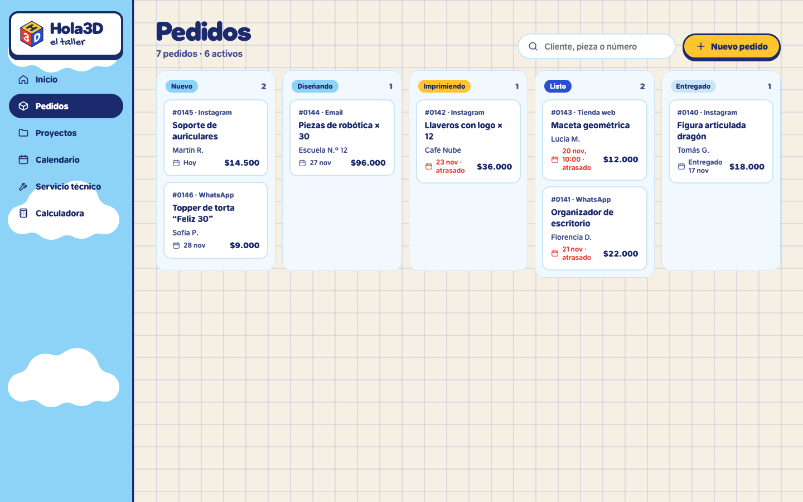

# Hola3D Taller

The internal workshop app for Hola3D, a 3D printing shop. It tracks every order from the first message to the delivery, on one board.



## Status

| Section | State |
|---|---|
| Pedidos (orders) | Works end to end: board, search, new order, stage moves |
| Inicio, Proyectos, Calendario, Servicio técnico, Calculadora | Placeholder screens |
| Deploy to `app.hola3d.com.ar` | Not done yet, see [Deploy](#deploy) |

The app has no login of its own. It is meant to run behind Cloudflare Access, so do not deploy it without that step.

## Run it locally

You need Node.js 22 or newer. Nothing here touches a Cloudflare account: the database is a local D1 copy.

```bash
npm install
npm run db:migrate   # create the local D1 tables
npm run db:seed      # load seven sample orders
npm run dev
```

Open the URL Vite prints and go to **Pedidos**.

## Checks

```bash
npm test             # Vitest: domain rules, API routes, formatting
npm run typecheck
npm run lint
```

## How it is built

One Cloudflare Worker serves both the React app and the API, and stores data in D1 (SQLite).

| Folder | What lives there |
|---|---|
| `src/` | React 19 app (Vite, React Router). `features/orders/` is the Pedidos screen, `shell/` the navigation |
| `worker/` | The Worker: API under `/api/*`, everything else is the single-page app |
| `shared/` | Order rules used by both sides: stages, validation, search |
| `migrations/` | D1 schema |
| `seed/` | Sample orders, for local use only |

An order moves through five stages, in order:

`nuevo` → `disenando` → `imprimiendo` → `listo` → `entregado`

## API

| Method | Path | What it does |
|---|---|---|
| GET | `/api/orders` | List all orders |
| POST | `/api/orders` | Create an order. It starts in `nuevo` and takes the next four-digit number |
| PUT | `/api/orders/:id/stage` | Move an order to another stage |

```bash
# Create an order
curl -X POST http://localhost:5173/api/orders \
  -H 'content-type: application/json' \
  -d '{"item":"Maceta geométrica","client":"Lucía M.","channel":"Instagram","price":12000}'

# Move order 0142 to "listo"
curl -X PUT http://localhost:5173/api/orders/0142/stage \
  -H 'content-type: application/json' \
  -d '{"stage":"listo"}'
```

A new order needs `item`, `client`, `channel` and `price` (whole pesos). `dueDate`, `dueTime`, `deposit`, `material` and `note` are optional. The channel is one of `Instagram`, `WhatsApp`, `Tienda web`, `Email` or `En persona`.

Errors come back as JSON with an `error` message in Spanish, since the app shows them as they are.

| Status | When |
|---|---|
| 400 | The body is not JSON |
| 404 | The order or the route does not exist |
| 405 | The method is not allowed on that path |
| 422 | Order data is missing or invalid (the answer adds `fields`, one message per field), or the stage does not exist |

## Deploy

None of these steps has been done yet. Each one creates something in the Cloudflare account.

1. `npx wrangler d1 create hola3d-app`, then paste the `database_id` into `wrangler.jsonc`.
2. `npx wrangler d1 migrations apply hola3d-app --remote`
3. Add the custom domain `app.hola3d.com.ar` to the Worker.
4. Put Cloudflare Access in front of that domain, so only the owners can sign in.
5. `npm run deploy`

## Credits

The interface font is [Allo](https://joshpuckett.me) by Josh Puckett, under the SIL Open Font License 1.1. Handwritten accents use [Gochi Hand](https://fonts.google.com/specimen/Gochi+Hand).
